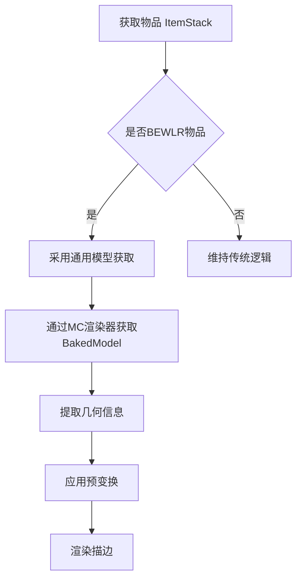

# 通用模型适配算法设计文档

## 1. 概述

本设计文档旨在为 Enchanted Outlines 项目创建一种通用的模型适配算法，以解决当前每个模组都需要单独适配的问题。该方案基于 Minecraft 原生渲染体系，通过通用模型获取方式替代现有硬编码字段映射方案。

## 2. 设计目标

### 2.1 核心目标
- 减少对特定模组的依赖和硬编码
- 提高项目扩展性和维护性
- 通过 Minecraft 原生渲染系统获取模型，确保准确性
- 保持与现有功能的兼容性

### 2.2 技术目标
- 统一获取 BEWLR 物品模型的方式
- 保持与多模组的兼容性
- 精确复刻渲染变换
- 支持所有标准 Minecraft 渲染路径

## 3. 算法设计

### 3.1 通用模型获取流程



### 3.2 关键实现点

#### 3.2.1 模型通用获取方法
```java
public BakedModel getUniversalModel(ItemStack stack) {
    // 利用Minecraft已有的模型解析逻辑
    return Minecraft.getInstance().getItemRenderer()
            .getItemModelShaper()
            .getModel(stack);
}
```

#### 3.2.2 通用BEWLR物体渲染器
```java
public boolean renderUniversalBewlrOutline(ItemStack stack, PoseStack pose, int color, float thickness) {
    // 1. 获取通用模型
    BakedModel model = getUniversalModel(stack);
    
    // 2. 获取变换信息
    ItemTransforms transforms = stack.getOrDefault(DataComponents.ITEM_NAME, ItemTransforms.NO_TRANSFORMS);
    
    // 3. 应用与原有的一致变换
    // 4. 渲染描边
}
```

#### 3.2.3 一致性变换处理
- 识别并应用标准的MC变换，如 `scale(1,-1,-1)` 和 `translate` 
- 支持不同显示场景（如 GUI、手持、固定位置）
- 处理动画相关的变换

### 3.3 实现策略

#### 3.3.1 逐步替换
- 逐步用通用逻辑替换现有反射逻辑
- 保持向后兼容性，如不支持的模组仍走原逻辑

#### 3.3.2 模型获取策略
1. **标准模型路径**：使用 `ItemRenderer` 的标准模型获取流程
2. **模型状态跟踪**：记录获取模型状态以提高性能
3. **缓存机制**：适度缓存获取的模型以提升性能

#### 3.3.3 渲染一致性保证
- 建立变换链条状态与原渲染路径的对应关系
- 精确复刻 `display` 变换
- 处理预变换机制（如BEWLR内部变换）

## 4. 文件变更规划

### 4.1 目标文件
- `OutlineRenderer.java` - 主要修改文件
- `ItemModelRegistry.java` - 可能需要更新注册逻辑
- `BewlrAdapter.java` - 可能的适配器重构

### 4.2 实现步骤

#### 第一阶段：基础通用模型处理
1. 添加 `getUniversalModel` 方法
2. 重构 `renderBewlrEntityOutline` 实现
3. 实现基础变换链复刻

#### 第二阶段：高级特性支持
1. 实现动画模型支持
2. 添加状态缓存机制
3. 完善错误处理机制

#### 第三阶段：兼容性处理
1. 支持退化到原有逻辑的路径
2. 添加错误日志和调试信息
3. 性能测试和优化

## 5. 预期收益

### 5.1 维护性
- 大幅减少硬编码适配逻辑
- 减少因模组更新导致的兼容性问题
- 更容易应对新模组的添加

### 5.2 扩展性
- 无需为新模组添加额外适配代码
- 通用机制天然支持所有使用标准MC渲染的模组
- 保持与原生MC结构的强一致性

### 5.3 通用性
- 向后兼容所有现有模组
- 更可靠的模型解析准确性
- 降低因字段映射错误导致的问题

## 6. 风险评估

### 6.1 技术风险
- 某些复杂模组可能需要特殊的处理方式
- 从渲染路径提取几何信息可能存在限制
- 性能考虑，通用获取可能比缓存详细字段慢

### 6.2 解决方案
- 保留现有反射适配方式作为备选
- 添加性能监控和优化机制
- 完善错误处理和回退逻辑

## 7. 测试计划

### 7.1 测试场景
1. **基础兼容性测试**：对比Mod与原生物品描边渲染效果
2. **性能测试**：比较通用方案与已有方案的性能差异
3. **兼容性测试**：确保无适配器的模组仍能正确工作

### 7.2 测试范围
- 多个BEWLR模组（如永恒星光、灾变、Hazen）
- 普通物品队列与特殊渲染路径
- 各种显示上下文（GUI、手持、固定）

## 8. 依赖与前提

### 8.1 项目依赖
- 项目已准备就绪，具备现有结构支持
- 已存在的API具有较高的通用性

### 8.2 环境要求
- Minecraft 1.21.1或更高版本
- 各类BEWLR模组
- 开发工作仅在 Java 代码中进行

## 9. 后续步骤

1. 开始设计实现API接口
2. 进行测试构建和验证
3. 进行压力测试和性能分析
4. 文档化对插件的更新