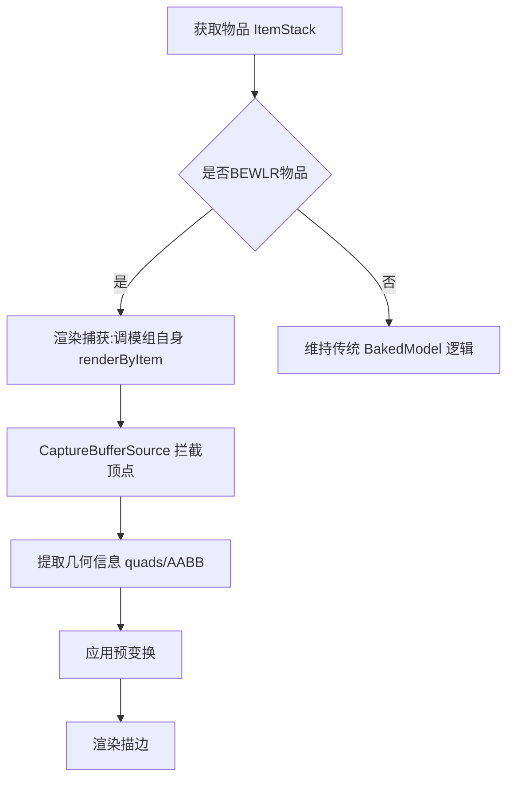
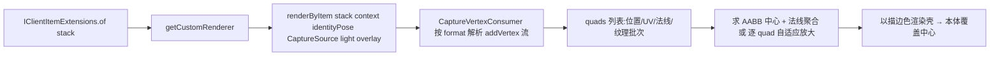

# 通用模型适配算法设计文档

> 📌 **文档状态(2026-09-06 重构后)**:本设计文档的核心"渲染捕获"方案已在
> `OutlineRenderer` 落地(`resolveBewlrRenderer` / `captureBewlrGeometry` /
> `renderBewlrCapturedOutline` / `CaptureSource`)。但后续实测与用户决策导致部分
> 计划<b>已中止</b>:TACZ 与 Hazen'N Stuff 的 BEWLR/Geo 描边兼容已<b>整体停用</b>
> (宁可无描边,不接受错位/错误轮廓);遗留的 `com.enchantedoutlines.mod.api`
> 适配层(ItemModelRegistry/ShapeDetector/RenderPipeline 等)确认是零引用死代码,
> 已<b>整包删除</b>。因此文中 §3.4.4 兼容矩阵、§4.1 文件规划里涉及这两家的条目
> 仅作历史参考,<b>不再作为实现目标</b>。本文档保留作为"通用渲染捕获"的设计依据。

## 1. 概述

本设计文档旨在为 Enchanted Outlines 项目创建一种通用的模型适配算法，以解决当前每个模组都需要单独适配的问题。该方案基于 Minecraft 原生渲染体系，通过通用模型获取方式替代现有硬编码字段映射方案。

> ⚠️ **2026-09-06 重大修正(基于对 TACZ / Hazen'N Stuff / 真菌感染 jar 的 javap 实证)**:
> 旧 §3.2.1 用 `ItemRenderer.getItemModelShaper().getModel(stack)` 取模型,对
> **BEWLR 物品(builtin/entity, `isCustomRenderer()==true`)** 是<b>错误的</b>——占位
> BakedModel 无任何 quads(几何根本不在 BakedModel 中)。BEWLR 的几何只存在于模组渲染器
> 每次 `renderByItem` 画出的顶点里(TACZ 自绘 Bedrock、Hazen 星怒 = GeckoLib GeoItem、
> 灾变 Lionfish、永恒星光 Mojang Model 皆是)。因此"通过 MC 渲染获取模型"的正确含义是:
> **调用模组自己的 `renderByItem`,把输出顶点捕获进内存**,而非查 BakedModel。
> 详见 §3.4。

## 2. 设计目标

### 2.1 核心目标
- 减少对特定模组的依赖和硬编码
- 提高项目扩展性和维护性
- 通过 Minecraft 原生渲染系统获取模型，确保准确性
- 保持与现有功能的兼容性

### 2.2 技术目标
- 统一获取 BEWLR 物品模型的方式
- 保持与多模组的兼容性
- 精确复刻渲染变换
- 支持所有标准 Minecraft 渲染路径

## 3. 算法设计

### 3.1 通用模型获取流程



### 3.2 关键实现点

#### 3.2.1 ~~模型通用获取方法~~(已废弃,见 §3.4)
```java
// ❌ 旧写法(对 BEWLR 无效):getModel 返回 builtin/entity 占位,无 quads
public BakedModel getUniversalModel(ItemStack stack) {
    return Minecraft.getInstance().getItemRenderer().getItemModelShaper().getModel(stack);
}
```

#### 3.2.2 通用 BEWLR 物体渲染器(草案)
```java
public boolean renderUniversalBewlrOutline(ItemStack stack, PoseStack pose, int color, float thickness) {
    // 见 §3.4 渲染捕获
}
```

#### 3.2.3 一致性变换处理
- 识别并应用标准的MC变换，如 `scale(1,-1,-1)` 和 `translate` 
- 支持不同显示场景（如 GUI、手持、固定位置）
- 处理动画相关的变换

### 3.3 实现策略

#### 3.3.1 逐步替换
- 逐步用通用逻辑替换现有反射逻辑
- 保持向后兼容性，如不支持的模组仍走原逻辑

#### 3.3.2 模型获取策略
1. **标准模型路径**：使用 `ItemRenderer` 的标准模型获取流程
2. **模型状态跟踪**：记录获取模型状态以提高性能
3. **缓存机制**：适度缓存获取的模型以提升性能

#### 3.3.3 渲染一致性保证
- 建立变换链条状态与原渲染路径的对应关系
- 精确复刻 `display` 变换
- 处理预变换机制（如BEWLR内部变换）

### 3.4 ⚠️ 渲染捕获(Render Capture)—— BEWLR 通用获取的唯一可靠路径

#### 3.4.1 原理
所有 BEWLR 物品(无论模组内部用 GeckoLib/AzureLib/Lionfish/Bedrock/自绘)最终都汇聚到
MC 的同一个渲染出口:

```java
// ItemRenderer.render 内部(1.21.1 vanilla/NeoForge 同款):
if (model.isCustomRenderer()) {
    IClientItemExtensions.of(stack).getCustomRenderer()
        .renderByItem(stack, context, pose, buffers, light, overlay);
}
```

因此在描边时机调用**同一个渲染器** `renderByItem`,把 `buffers` 换成捕获用
`MultiBufferSource`,即可获得与本体**100% 同变换、同姿态**的顶点——零反射、零字段猜测。

#### 3.4.2 捕获器设计



- 捕获 `MultiBufferSource.getBuffer(rt)` 按需返回**同一** CaptureVertexConsumer;
- CaptureVertexConsumer 实现 5 个抽象 `addVertex/setUv/setColor/setUv2/setNormal`
  (其余 default 由流式 API 转调),按 `rt.format()` 的 stride 把连续字节解析成
  `{x,y,z,u,v,nx,ny,nz}` 顶点;每 4 顶点(QUADS)/3 顶点(TRIANGLES)收成 quad;
- `renderByItem` 内部自带全部动画/预变换/display 子变换,捕获到的就是本体实际几何;
  描边只需整体法线外扩或 AABB 放大壳(见 §3.4.3)。

#### 3.4.3 描边几何(对捕获几何)
1. **整体 AABB 放大壳**(最通用、无裂缝,与 `renderLionfishInflated` 同思路):
   `pose.translate(c).scale(1+δ).translate(-c)` 后按 quad 重放,端部外扩略多;
2. **逐 quad 自适应放大**(精化,后续):每个 quad 绕自身中心放大、按半对角线
   补足厚度,与 `renderPartInflated(uniform=true)` 同思路。

#### 3.4.4 兼容矩阵(捕获兜底应放在现有反射快路径之后)
| 场景 | 优先快路径 | 捕获兜底 | 说明 |
|---|---|---|---|
| TACZ 手持 3D Bedrock | 无(自绘) | ✅ renderByItem 捕获 3D | GUI 2D slot 平面另走平面/纹理路径 |
| Hazen 星怒 = GeckoLib GeoItem | `renderGeoItemOutline`(GeoRenderProvider) | ✅ 若 Geo 兜底拿不到 | Geo 优先、捕获兜底双保险 |
| 灾变 Lionfish | `renderLionfishPerCube` | ✅ | 字段失效时仍可有描边 |
| 永恒星光 Mojang Model | `renderEntityModelOutline` | ✅ | 同上 |

#### 3.4.5 已知风险与对策
- 某些渲染器依赖 world/player/动画上下文,捕获可能返回空或抛异常
  → 全部 try-catch,空结果返回 false,不影响本体;
- 捕获在每帧进行有性能开销 → 按 (ItemStack 关键 NBT) 缓存静态几何,动画物品
  每帧捕获(参考现有 ModelGeometry 缓存纪律 AGENTS.md #4);
- capture 过程中 `endBatch` 不得触发(否则把本体几何画到屏幕上)→ 捕获 source
  的 endBatch 为空操作,仅收集;
- TACZ 的 Bedrock 渲染内部可能自建临时 buffer → 捕获需在其 `renderByItem`
  使用的同一 buffer 出口拦截(若 TACZ 自带 static model 且 GUI 走
  `renderSlotTexture`,GUI 用 slot 纹理形状路径而非捕获)。

## 4. 文件变更规划

### 4.1 目标文件
- `OutlineRenderer.java` - 主要修改文件(渲染捕获兜底 + getUniversalBewlrModel 真实现)
- `api/adapter/ItemModelRegistry.java` - 目前是未接线死代码,若启用需在
  GuiGraphics/ItemRenderer 链路接入,或废弃
- `BewlrAdapter.java` - 可能的适配器重构

### 4.2 实现步骤

#### 第一阶段：基础通用模型处理(渲染捕获)
1. 新增 `CaptureMultiBufferSource` + `CaptureVertexConsumer`(见 §3.4.2)
2. `renderBewlrEntityOutline` 现有反射/Geo 全部失败后,追加捕获兜底
3. TACZ:取消命名空间一刀切 return false,手持改走捕获 3D;GUI 2D slot 另处理
4. Hazen 星怒等 GeckoLib GeoItem:确认 `renderGeoItemOutline` 为何未命中
   (可能 GeoRenderProvider 需延迟初始化),必要时加捕获

#### 第二阶段：高级特性支持
1. 实现动画模型支持
2. 添加状态缓存机制
3. 完善错误处理机制

#### 第三阶段：兼容性处理
1. 支持退化到原有逻辑的路径
2. 添加错误日志和调试信息
3. 性能测试和优化

## 5. 预期收益

### 5.1 维护性
- 大幅减少硬编码适配逻辑
- 减少因模组更新导致的兼容性问题
- 更容易应对新模组的添加

### 5.2 扩展性
- 无需为新模组添加额外适配代码
- 通用机制天然支持所有使用标准MC渲染的模组
- 保持与原生MC结构的强一致性

### 5.3 通用性
- 向后兼容所有现有模组
- 更可靠的模型解析准确性
- 降低因字段映射错误导致的问题

## 6. 风险评估

### 6.1 技术风险
- 某些复杂模组可能需要特殊的处理方式
- 从渲染路径提取几何信息可能存在限制
- 性能考虑，通用获取可能比缓存详细字段慢

### 6.2 解决方案
- 保留现有反射适配方式作为备选
- 添加性能监控和优化机制
- 完善错误处理和回退逻辑

## 7. 测试计划

### 7.1 测试场景
1. **基础兼容性测试**：对比Mod与原生物品描边渲染效果
2. **性能测试**：比较通用方案与已有方案的性能差异
3. **兼容性测试**：确保无适配器的模组仍能正确工作

### 7.2 测试范围
- 多个BEWLR模组（如永恒星光、灾变、Hazen）
- 普通物品队列与特殊渲染路径
- 各种显示上下文（GUI、手持、固定）

## 8. 依赖与前提

### 8.1 项目依赖
- 项目已准备就绪，具备现有结构支持
- 已存在的API具有较高的通用性

### 8.2 环境要求
- Minecraft 1.21.1或更高版本
- 各类BEWLR模组
- 开发工作仅在 Java 代码中进行

## 9. 后续步骤

1. 开始设计实现API接口
2. 进行测试构建和验证
3. 进行压力测试和性能分析
4. 文档化对插件的更新